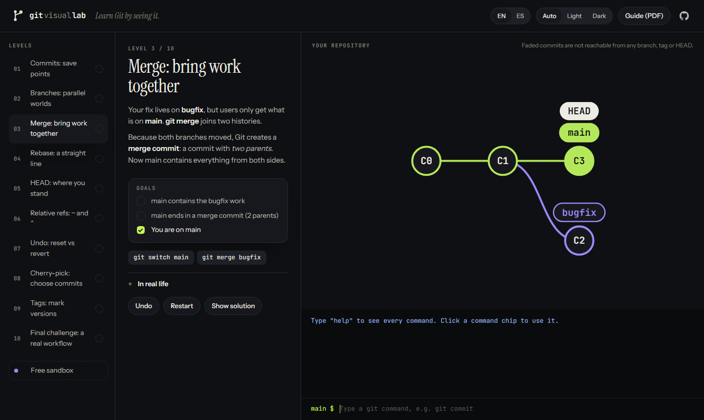

# Git Visual Lab

**Aprende Git viéndolo.** Escribe comandos `git` reales y mira cómo cambia el grafo de commits en vivo. 10 niveles cortos, un modo libre y una guía para imprimir. En inglés y español.

**▶ Juégalo:** https://davidcostacv.github.io/git-visual-lab/ (botón **ES** arriba a la derecha)
**📄 Guía (PDF):** [Español](docs/git-visual-lab-guide-es.pdf) · [English](docs/git-visual-lab-guide-en.pdf)
**🇬🇧** [Read in English](README.md)



---

## Qué aprendes

| # | Nivel | Comandos |
|---|-------|----------|
| 1 | Commits: puntos de guardado | `git commit` |
| 2 | Ramas: mundos paralelos | `git switch -c` |
| 3 | Merge: juntar el trabajo | `git merge` |
| 4 | Rebase: historia en línea recta | `git rebase` |
| 5 | HEAD: dónde estás parado | `git checkout <commit>` |
| 6 | Referencias relativas | `main~2`, `HEAD^`, `git branch -f` |
| 7 | Deshacer: reset vs revert | `git reset`, `git revert` |
| 8 | Cherry-pick | `git cherry-pick` |
| 9 | Tags: marcar versiones | `git tag` |
| 10 | Desafío final | rama → `merge --no-ff` → tag |

Cada nivel tiene una lección corta en palabras simples, objetivos que se ponen en verde mientras juegas, una nota de "en la vida real", deshacer/reiniciar y la solución si te trancas.

Mis propias soluciones, explicadas paso a paso: **[EXERCISES.es.md](EXERCISES.es.md)**.

## Cómo funciona

```
 escribes "git merge bugfix"
          │
          ▼
 src/engine.js   Un simulador pequeño de Git: commits, ramas, tags, HEAD.
          │      Lógica pura, sin navegador, así que está todo probado.
          ▼
 src/layout.js   Convierte el repositorio en posiciones: un carril por rama,
          │      los commits viejos a la izquierda.
          ├──────────────────────────────┐
          ▼                              ▼
 src/app.js  (la página)         scripts/build-pdf.mjs  (la guía PDF)
 grafo SVG animado               los mismos grafos, impresos
```

- **Una sola fuente de verdad.** Los niveles de `src/levels.js` alimentan la app, los tests y el PDF.
- **Cada nivel está probado.** Tiene que empezar sin resolver, su solución tiene que resolverlo y algunas respuestas equivocadas tienen que fallar.
- **Un error nunca rompe el repo.** Si un comando falla a mitad de camino, el repositorio vuelve exactamente a como estaba.
- **Sin build ni framework.** HTML, CSS y módulos de JavaScript, revisados con TypeScript vía JSDoc.

## Cómo este repo muestra Git en la práctica

El proyecto se construyó con el mismo flujo que enseña:

- **Una rama por función, cada una unida con un pull request** ([PRs cerrados](https://github.com/davidcostacv/git-visual-lab/pulls?q=is%3Apr+is%3Aclosed)).
- **Commits de merge** que dejan cada función visible en la historia.
- **Un rebase real:** la rama de la app web empezó antes de que se unieran los niveles, así que se hizo rebase sobre `main` antes de su pull request.
- **CI** corre typecheck, lint y tests en cada push y pull request.
- **Un tag y un release:** `v1.0.0`, con los dos PDFs adjuntos.

## Correrlo en tu PC

```bash
git clone https://github.com/davidcostacv/git-visual-lab.git
cd git-visual-lab
npm install
npm start          # http://localhost:5173
npm run check      # typecheck + lint + tests
```

## Licencia

MIT
