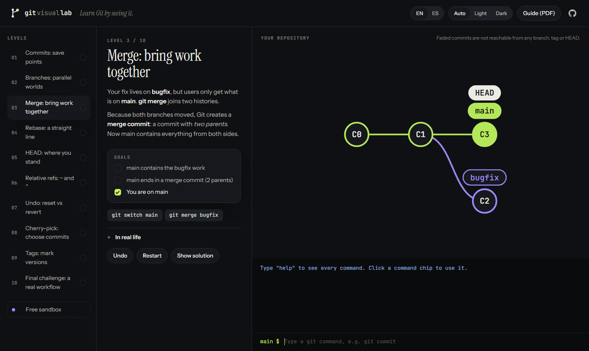

# Git Visual Lab

**Learn Git by seeing it.** Type real `git` commands and watch the commit graph change, live. 10 short levels, a free sandbox, and a printable guide. English and Spanish.

**▶ Play it:** https://davidcostacv.github.io/git-visual-lab/
**📄 Guide (PDF):** [English](docs/git-visual-lab-guide-en.pdf) · [Español](docs/git-visual-lab-guide-es.pdf)
**🇪🇸** [Leer en español](README.es.md)



---

## What you learn

| # | Level | Commands |
|---|-------|----------|
| 1 | Commits: save points | `git commit` |
| 2 | Branches: parallel worlds | `git switch -c` |
| 3 | Merge: bring work together | `git merge` |
| 4 | Rebase: a straight line | `git rebase` |
| 5 | HEAD: where you stand | `git checkout <commit>` |
| 6 | Relative refs | `main~2`, `HEAD^`, `git branch -f` |
| 7 | Undo: reset vs revert | `git reset`, `git revert` |
| 8 | Cherry-pick | `git cherry-pick` |
| 9 | Tags: mark versions | `git tag` |
| 10 | Final challenge | branch → `merge --no-ff` → tag |

Each level has a short lesson in plain words, goals that turn green as you play, an "in real life" note, undo/restart, and a solution if you get stuck.

My own solutions, explained step by step: **[EXERCISES.md](EXERCISES.md)**.

## How it works

```
 you type "git merge bugfix"
          │
          ▼
 src/engine.js   A small Git simulator: commits, branches, tags, HEAD.
          │      Pure logic, no browser needed, so it is fully tested.
          ▼
 src/layout.js   Turns the repository into positions: one lane per branch,
          │      older commits on the left.
          ├──────────────────────────────┐
          ▼                              ▼
 src/app.js  (web page)          scripts/build-pdf.mjs  (PDF guide)
 animated SVG graph              the same graphs, printed
```

- **One source of truth.** The levels in `src/levels.js` feed the app, the tests and the PDF. If a level changes, all three stay in sync.
- **Every level is tested.** It must start unsolved, its official solution must solve it, and some wrong answers must fail (`tests/levels.test.js`).
- **Errors never break the repo.** If a command fails half-way, the repository goes back to exactly how it was.
- **No build step, no framework.** Plain HTML, CSS and JavaScript modules, type-checked with TypeScript through JSDoc.
- **Accessible motion.** Only `transform` and `opacity` are animated, and `prefers-reduced-motion` is respected.

## How this repo shows Git in practice

The project was built with the same workflow it teaches:

- **One branch per feature, each merged through a pull request** ([closed PRs](https://github.com/davidcostacv/git-visual-lab/pulls?q=is%3Apr+is%3Aclosed)): engine → graph layout → levels → web app → docs.
- **Merge commits** keep each feature visible in the history (`git log --graph` below).
- **A real rebase:** the web app branch started before the levels were merged, so it was rebased onto `main` before its pull request.
- **CI** runs typecheck, lint and tests on every push and pull request.
- **A tag and a release:** `v1.0.0`, with both PDFs attached.

See it yourself: open the [network graph](https://github.com/davidcostacv/git-visual-lab/network) or clone the repo and run `git log --graph --oneline --all`.

## Run it locally

```bash
git clone https://github.com/davidcostacv/git-visual-lab.git
cd git-visual-lab
npm install
npm start          # http://localhost:5173
npm run check      # typecheck + lint + tests
npm run pdf        # rebuild the PDF guides (needs Chrome or Edge)
```

## Project structure

```
index.html, styles.css   the page and its design system (light/dark tokens)
src/engine.js            Git simulator
src/layout.js            graph layout + SVG
src/levels.js            the 10 levels (EN/ES) and their goals
src/i18n.js              every message in English and Spanish
src/app.js               connects everything to the page
scripts/build-pdf.mjs    builds docs/*.pdf from the levels
tests/                   node:test suites
```

## License

MIT
